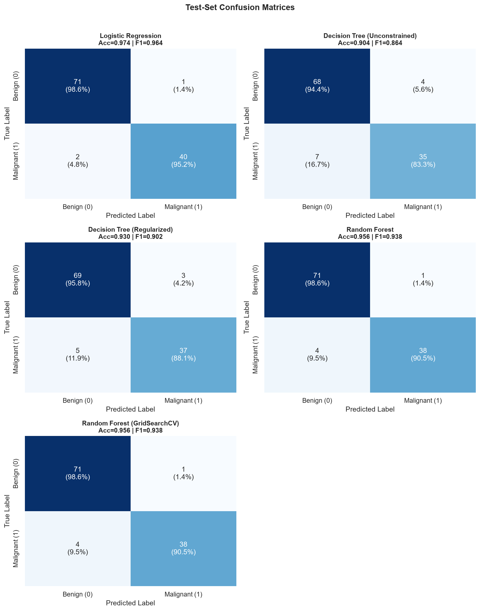
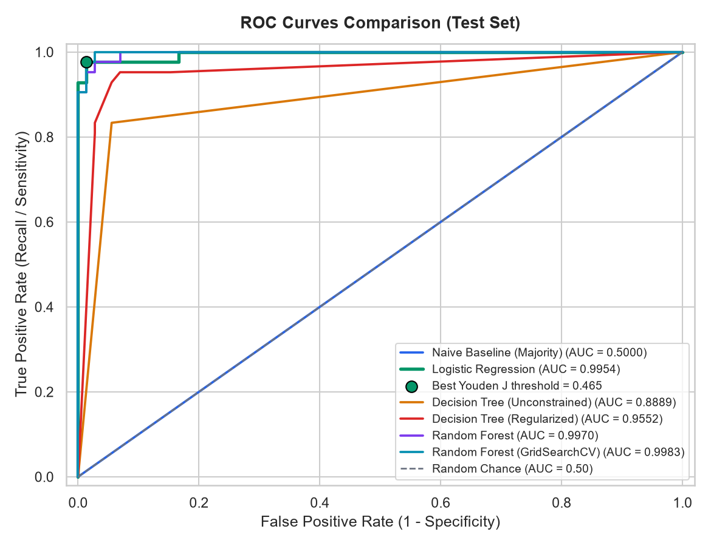
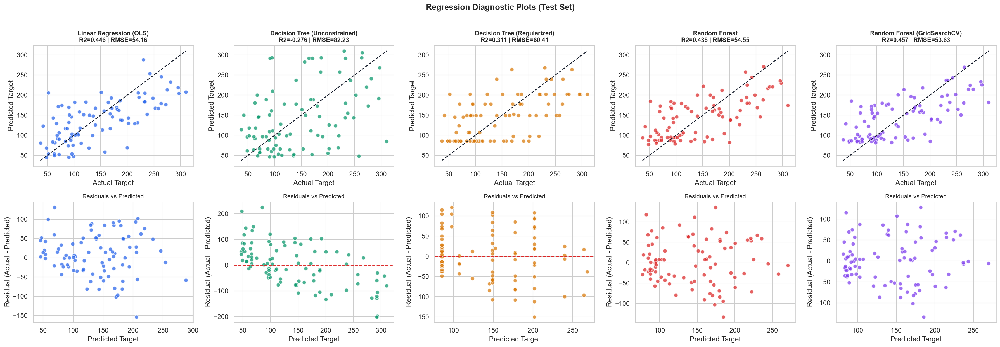

# Predictive Modeling Using Machine Learning

An end-to-end supervised machine learning project covering **Classification** and **Regression**, comparing baseline linear models, Decision Trees (unconstrained vs. regularized), and Random Forests with rigorous validation, confusion matrices, ROC/AUC curves, residual diagnostics, and 95% bootstrap confidence intervals.

## Features

- **Two Complete Supervised Learning Tracks + Custom CSV Support**
  - **Classification Track** (`breast_cancer`): Predicts tumor malignancy (`1 = Malignant`, `0 = Benign`) using `DummyClassifier`, `LogisticRegression`, `DecisionTreeClassifier` (unconstrained & depth-regularized), and `RandomForestClassifier` (plus `GridSearchCV` tuning).
  - **Regression Track** (`diabetes`): Predicts quantitative disease progression using `DummyRegressor`, `LinearRegression`, `DecisionTreeRegressor` (unconstrained & depth-regularized), and `RandomForestRegressor` (plus `GridSearchCV` tuning).
  - **Custom CSV Support**: Run the full training, tuning, evaluation, and plotting pipeline on any CSV dataset with `--data` and `--target`.
- **Leakage-Free Preprocessing**
  - Strictly splits datasets into **Train (60%) / Validation (20%) / Test (20%)** before fitting missing-value imputers, scalers, or encoders.
  - Handles missing numeric values with median imputation (+ missingness indicators when missing values occur) and categorical values with mode imputation + capped one-hot encoding (`max_categories=20`).
- **Comprehensive Model Evaluation & Visualizations**
  - **Classification**: Accuracy, Balanced Accuracy, Precision, Recall, Specificity, F1-Score, ROC-AUC, PR-AUC, Confusion Matrices (counts + normalized rates), ROC Curves with AUC & Youden's J threshold markers, and Precision-Recall Curves.
  - **Regression**: MAE, MSE, RMSE, $R^2$, Actual vs. Predicted scatter plots, and Residual diagnostic plots.
  - **Robustness & Diagnostics**: 5-fold Cross-Validation, Train-vs-Validation overfitting comparison, 95% Bootstrap Confidence Intervals, Slice-Based Error Analysis, and Feature Importance plots.

## Project Structure

```text
predictive-modeling-ml/
├── data/
│   └── raw/                         # Exported sample datasets (breast_cancer.csv, diabetes.csv)
├── notebooks/
│   └── predictive_modeling_walkthrough.ipynb  # Interactive step-by-step executed notebook
├── outputs/
│   ├── classification/              # Saved model (.joblib), metrics.json, report.md, PNG plots
│   └── regression/                  # Saved model (.joblib), metrics.json, report.md, PNG plots
├── src/
│   └── predictive_modeling/
│       ├── __init__.py
│       ├── cli.py                   # CLI entry point
│       ├── data.py                  # Dataset loaders, quality validation, 3-way splitting
│       ├── evaluation.py            # Metrics, cross-validation, bootstrap CIs, slice error analysis
│       ├── models.py                # Model specs and GridSearchCV tuning
│       ├── pipeline.py              # End-to-end experiment orchestration and inference
│       ├── preprocessing.py         # Leakage-free ColumnTransformer builder
│       └── visualization.py         # Confusion matrix, ROC/AUC, PR, regression, importance plots
├── tests/                           # Pytest suite verifying leakage-free preprocessing & pipeline
├── pyproject.toml
├── requirements.txt
└── run_project.py                   # Convenience runner script
```

## Quick Start

### 1. Create a virtual environment and install dependencies

```powershell
python -m venv .venv
.venv\Scripts\python.exe -m pip install -r requirements.txt
```

### 2. Run both Classification and Regression pipelines

```powershell
.venv\Scripts\python.exe run_project.py run --task both
```

This generates trained `.joblib` pipelines, `metrics.json`, `report.md`, and plots under `outputs/classification/` and `outputs/regression/`.

### 3. Run on your own CSV dataset

```powershell
.venv\Scripts\python.exe run_project.py run --data path\to\your_dataset.csv --target target_column --task auto --output-dir outputs\custom
```

### 4. Make predictions on new samples

```powershell
.venv\Scripts\python.exe run_project.py predict --model outputs\classification\best_model.joblib --input data\raw\breast_cancer.csv --output outputs\predictions.csv
```

### 5. Run automated tests

```powershell
.venv\Scripts\python.exe -m pytest -v
```

## Results & Visualizations

### Classification (`breast_cancer_diagnostic`, `1 = Malignant`, `0 = Benign`)

| Model | Train Acc | Val Acc | Test Acc | Test F1 | Test ROC-AUC |
| :--- | ---: | ---: | ---: | ---: | ---: |
| Naive Baseline (Majority) | 0.6276 | 0.6228 | 0.6316 | 0.0000 | 0.5000 |
| **Logistic Regression** (Selected on Val) | 0.9883 | 0.9737 | **0.9737** | **0.9639** | 0.9954 |
| Decision Tree (Unconstrained) | 1.0000 | 0.8947 | 0.9035 | 0.8642 | 0.8889 |
| Decision Tree (Regularized) | 0.9736 | 0.9035 | 0.9298 | 0.9024 | 0.9552 |
| Random Forest | 0.9941 | 0.9737 | 0.9561 | 0.9383 | 0.9970 |
| Random Forest (`GridSearchCV`) | 0.9941 | 0.9737 | 0.9561 | 0.9383 | **0.9983** |





### Regression (`diabetes_progression`)

| Model | Train $R^2$ | Val $R^2$ | Test $R^2$ | Test RMSE | Test MAE |
| :--- | ---: | ---: | ---: | ---: | ---: |
| Naive Baseline (Mean) | 0.0000 | -0.0443 | -0.0031 | 72.9002 | 63.5314 |
| **Linear Regression (OLS)** (Selected on Val) | 0.5203 | **0.5216** | 0.4464 | 54.1564 | **42.9245** |
| Decision Tree (Unconstrained) | 1.0000 | 0.2025 | -0.2764 | 82.2349 | 65.5506 |
| Decision Tree (Regularized) | 0.6137 | 0.3196 | 0.3113 | 60.4061 | 48.5994 |
| Random Forest | 0.8816 | 0.4704 | 0.4384 | 54.5466 | 44.5518 |
| Random Forest (`GridSearchCV`) | 0.6862 | 0.4700 | **0.4571** | **53.6337** | 43.2546 |



